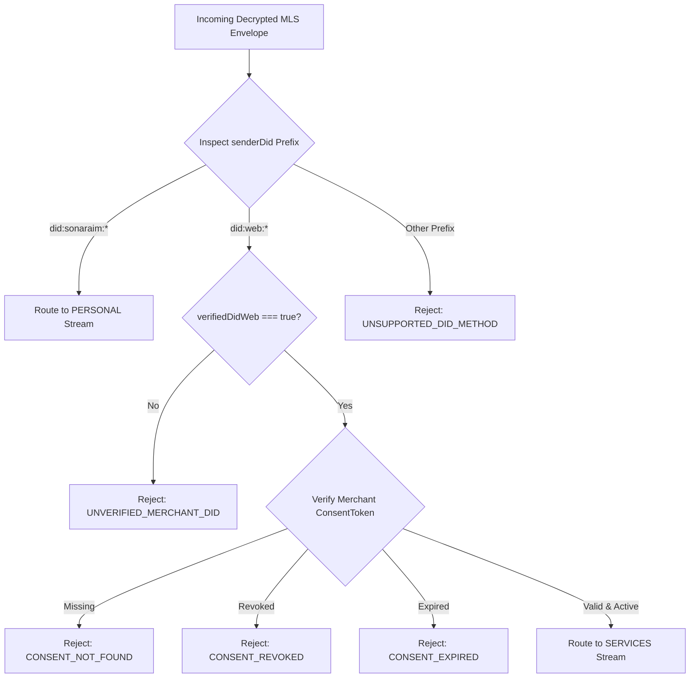
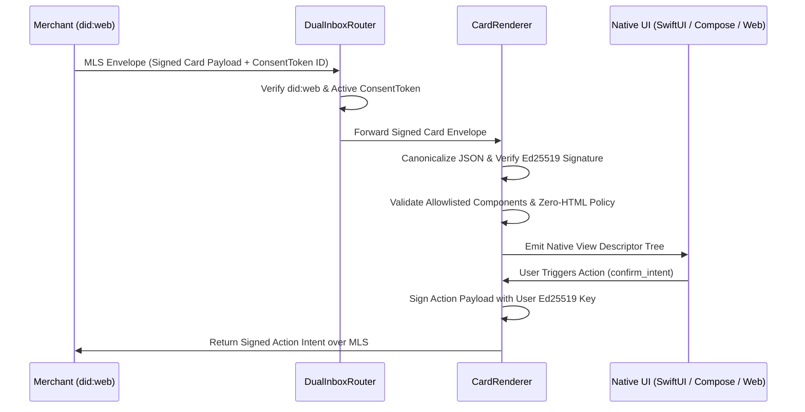
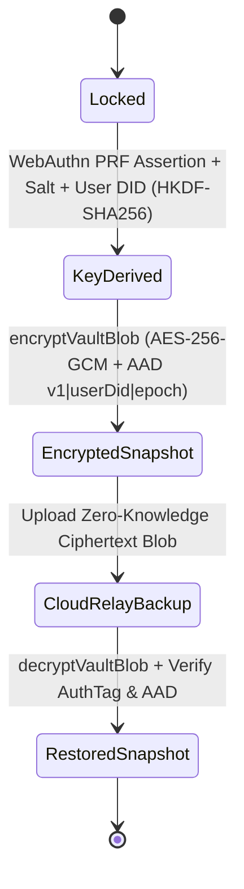

# System Diagrams (`docs/DIAGRAMS.md`)

> Mermaid Architecture, Sequence, and State Diagrams for `sonaraim-app`

## 1. Dual Inbox Envelope Routing Flow

## 2. Zero-HTML Declarative Card Verification & Action Signing

## 3. Passkey WebAuthn PRF Zero-Knowledge Vault Lifecycle

